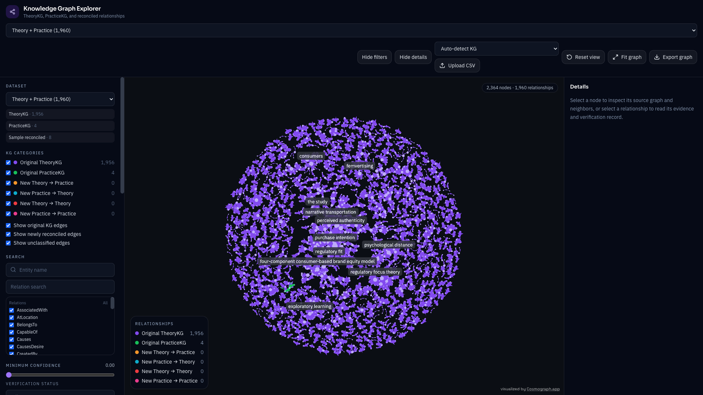
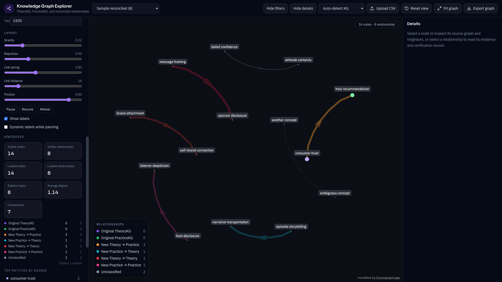

# Knowledge Graph Explorer

Interactive knowledge-graph explorer for TheoryKG, PracticeKG, and newly reconciled relationships. The app is a static React site: CSV files are parsed in the browser and drawn with Cosmograph’s GPU force-directed layout.





## Features

- Full-screen dark graph with zoom, pan, node dragging, and animated layout
- Directed edges, neighbor highlighting, and one-hop / two-hop isolation
- Presets for TheoryKG, PracticeKG, the combined graph, and a synthetic reconciled sample
- Local multi-file CSV upload, with hosted files loaded from `public/data` when they are present
- Six relationship colors, plus an unclassified state when provenance is ambiguous
- Explicit `color_code` / `color-code` overrides
- Source-aware node identities (`Theory::Trust` stays distinct from `Practice::Trust`)
- Parallel triples are kept as separate records and listed in the details panel
- Search, relation filters, confidence threshold, and verification-status filter
- Evidence, verdicts, and podcast or episode metadata when those fields exist
- Live statistics computed from the loaded graph
- PNG export of the current view and CSV export of the filtered triples
- Performance mode that keeps the highest-confidence subset of a large filtered graph

## Graph sizes in the local research files

These counts come from the CSV files in this directory. They are not bundled into the public site.

| Dataset | Triples | Notes |
| --- | ---: | --- |
| TheoryKG | 1,956 | 2,359 entities, 36 relations, 18 endpoint pairs with a parallel triple |
| PracticeKG | 4 | 5 entities, 3 relations, podcast and verification-status fields |

TheoryKG has no empty required fields. PracticeKG has one empty `review_reason`. Extraction confidence ranges from 0.6 to 1.0 in TheoryKG and 0.7 to 0.9 in PracticeKG.

## Installation

```bash
npm install
```

Node.js 22 is used in GitHub Actions. Local development was verified with Node 20.18 and Vite 7, which prints an engine warning but still builds.

## Run locally

```bash
npm run dev
```

Open the URL Vite prints (usually `http://127.0.0.1:5173/`).

To load the research files automatically, copy them into the public data folder without modifying the originals:

```bash
cp theorykg.csv practicekg.csv public/data/
```

The dev server then fetches:

- `public/data/theorykg.csv`
- `public/data/practicekg.csv`
- `public/data/sample-reconciled.csv`

If a preset file is missing, upload still works. Use **Upload CSV** or drop a file on the window.

```bash
npm test
npm run build
npm run preview
```

The production preview is served under `/KG-visualizer/` because that is the GitHub Pages base path.

## CSV format

Required columns:

```text
head, relation, tail
```

Every other column is preserved and shown in the details panel when it has a value. Useful columns from the research extracts include `triple_id`, `paper_id`, `head_type`, `tail_type`, `evidence_ids`, `evidence_quotes`, `extraction_confidence`, `verdict`, `verdict_confidence`, `verification_explanation`, and, for PracticeKG, `verification_status`, `ep_title`, `pod_title`, `episode_id`, and `source_podcast_id`.

Quoted commas, embedded line breaks, escaped quotes, Unicode, and missing cells are parsed with Papa Parse. Rows missing `head`, `relation`, or `tail` are skipped. A file missing those columns is rejected with an error and does not replace the current graph.

### Original TheoryKG and PracticeKG

Files named like `theorykg.csv` or `practicekg.csv`, or uploads classified as **Original TheoryKG** / **Original PracticeKG**, are colored as original relationships when a row has no provenance columns:

| Source | Category | Color |
| --- | --- | --- |
| TheoryKG | Original TheoryKG | `#8B5CF6` |
| PracticeKG | Original PracticeKG | `#22C55E` |

Node ids use the knowledge-graph source, not `head_type` or `tail_type`.

### Reconciled relationships

Optional columns:

```text
head_kg, tail_kg, edge_origin, kg_category, color_code, text
```

`color-code` is accepted as an alias of `color_code`.

| Category | Color |
| --- | --- |
| Original TheoryKG | `#8B5CF6` |
| Original PracticeKG | `#22C55E` |
| New Theory → Practice | `#F59E0B` |
| New Practice → Theory | `#06B6D4` |
| New Theory → Theory | `#EF4444` |
| New Practice → Practice | `#EC4899` |
| Unclassified | `#94A3B8` |

Classification rules:

- `kg_category` wins when it names one of the categories above.
- `edge_origin` of `original` plus a Theory or Practice endpoint becomes the matching original category.
- `edge_origin` of `new` (or `reconciled`) plus `head_kg` / `tail_kg` becomes T→P, P→T, T→T, or P→P.
- A cross-graph pair with no origin is still T→P or P→T, because an original single-graph edge cannot connect the two graphs.
- Theory→Theory or Practice→Practice without `edge_origin: new` stays **Unclassified**. Those edges are not treated as original TheoryKG or PracticeKG.
- A valid hex `color_code` overrides the palette color and does not change the category.
- Anything still ambiguous stays unclassified.

`public/data/sample-reconciled.csv` is synthetic and is safe to publish. It demonstrates all four new categories, a color override, parallel edges, and two unclassified rows.

## Deployment

Production builds use this base path:

```text
https://agnik2019.github.io/KG-visualizer/
```

`vite.config.ts` sets `base` to `/KG-visualizer/` for production builds and `/` for the dev server. Dataset fetches use `import.meta.env.BASE_URL`.

`.github/workflows/deploy.yml` is the GitHub Actions workflow that tests, builds, and deploys `dist` to GitHub Pages on every push to `main`. The personal access token stored on this machine has the `repo` scope and not the `workflow` scope, so GitHub rejected pushing that file. The source repository was published without it, and the current site is published from the `gh-pages` branch. After the token is granted the `workflow` scope, commit and push `.github/workflows/deploy.yml`, then set Pages to “GitHub Actions” so later pushes deploy automatically.

The workflow file is:

```yaml
name: Deploy to GitHub Pages

on:
  push:
    branches: [main]
  workflow_dispatch:

permissions:
  contents: read
  pages: write
  id-token: write

concurrency:
  group: pages
  cancel-in-progress: true

jobs:
  build:
    runs-on: ubuntu-latest
    steps:
      - uses: actions/checkout@v4
      - uses: actions/setup-node@v4
        with:
          node-version: 22
          cache: npm
      - run: npm ci
      - run: npm test
      - run: npm run build
      - uses: actions/upload-pages-artifact@v3
        with:
          path: dist

  deploy:
    needs: build
    runs-on: ubuntu-latest
    environment:
      name: github-pages
      url: ${{ steps.deployment.outputs.page_url }}
    steps:
      - id: deployment
        uses: actions/deploy-pages@v4
```

### Research data is not in the public site

`theorykg.csv` and `practicekg.csv` are research extracts. They are listed in `.gitignore`, including copies under `public/data/`, so they are not committed or deployed. The public app still loads them if you upload the files, and it loads them automatically in local development when the copies exist.

To publish those datasets later, remove the matching `.gitignore` lines, commit the files under `public/data/`, and push. Anyone who can open the site will be able to download them.

## Known limitations

- Cosmograph draws parallel edges on top of each other. Every triple is still stored, and the details panel lists each one.
- GitHub Pages cannot set cross-origin isolation headers. The app is built to run without those headers.
- Very large uploads should use performance mode. It shows the highest-confidence relationships up to the chosen cap and leaves the rest available when the cap is turned off.
- There is no backend, editing, or persistence beyond the browser session.
- The force layout is two-dimensional.

## Project layout

```text
src/components/   Graph, sidebars, legend, statistics, upload
src/utils/        CSV parsing, classification, graph build, filters, stats
src/types/        Shared graph types
public/data/      Hosted CSVs (research files stay gitignored)
.github/workflows/deploy.yml
```
